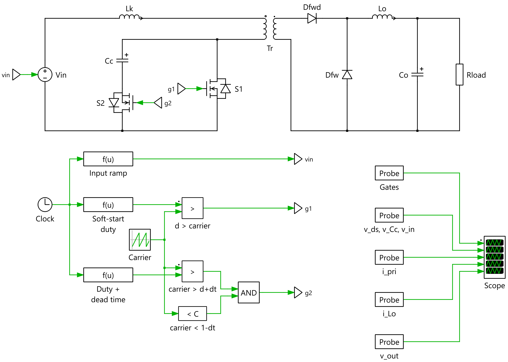

# Active-Clamp Forward Converter – Clamp Precharge

PLECS Standalone model of an active-clamp forward converter (low-side clamp). It shows how to
**precharge the clamp capacitor** at startup so the converter does not draw a large inrush current.

The model is self-contained. Every signal is generated inside PLECS, so it needs no external
files, CSV stimulus, C-Script or MATLAB.

## Running

1. Open `activeClampPrecharge.plecs` in PLECS 4.9 (Standalone).
2. Press **Simulation ▸ Start** (Ctrl+T).
3. Double-click **Scope** to view the waveforms.

You can change every parameter in **Simulation ▸ Simulation Parameters ▸ Initialization**.

## Circuit

| Part | Description |
|------|-------------|
| `Vin` | Controlled input source. It ramps from 0 to 48 V during precharge. |
| `Lk`, `Tr` | Leakage inductance and a 2:1 transformer with magnetizing inductance `Lm`. |
| `S1` | Main switch (MOSFET with body diode). |
| `Cc`, `S2` | Active clamp branch (low-side clamp capacitor + auxiliary switch). |
| `Dfwd`, `Dfw` | Forward and freewheeling rectifier diodes. |
| `Lo`, `Co`, `Rload` | Output filter and load. |

### Control (bottom of the schematic)

- **Carrier**: a 0→1 sawtooth at `fsw`.
- **Soft-start duty**: `d = D·min(max(t−Tpre,0)/Tss, 1)`.
- **g1 (S1)**: `d > carrier`.
- **g2 (S2)**: `carrier > d + tdead·fsw` AND `carrier < 1 − tdead·fsw`. This makes g2 the
  complement of g1, with dead time on both edges. S2 stays off while `t < Tpre`.
- **Input ramp**: `Vin·min(t/Tpre, 1)`.

Gate signals reach the power stage through the Goto/From tags `g1`, `g2` and `vin`.

## Startup sequence

| Phase | Time | What happens |
|-------|------|--------------|
| 1. Precharge | 0 → `Tpre` (0.3 ms) | Both gates are off and Vin ramps up. Cc charges to Vin through the primary and the body diode of S2. Because dv/dt is small, the current stays small. |
| 2. Soft-start | `Tpre` → `Tpre+Tss` | The duty cycle ramps from 0 to D. Cc rises from Vin to Vin/(1−D). |
| 3. Steady state | after ≈1.3 ms | The converter runs at D = 0.4. |

### Why precharge is needed

Without precharge, Cc starts at 0 V. At power-up, Vin is applied directly across Lk and the
primary through the clamp loop. This charges Cc resonantly in a few µs. In the first version of
this model, that caused:

- a **4.7 A** primary current spike;
- Cc overshooting to **82 V**;
- a **5 A** kick into the output inductor.

With the Vin ramp, the primary current during precharge stays below **0.14 A**.

## Simulated results (default parameters)

| Quantity | Expected | Simulated |
|----------|----------|-----------|
| Cc voltage after precharge | Vin = 48 V | 48.2 V |
| Peak primary current during precharge | – | 0.14 A |
| Clamp voltage / peak drain voltage (steady state) | Vin/(1−D) = 80 V | 80.9 V |
| Output voltage | Vin·D·Ns/Np − Vf ≈ 9.2 V | 9.05 V |
| Output current | Vout/Rload | 4.5 A |
| S1/S2 gate overlap | none | none |

The output is slightly below the ideal value because of the rectifier drop and the duty-cycle
loss from the leakage inductance. The full scope traces are in [doc/data.csv](doc/data.csv).

## Default parameters

| Name | Value | Meaning |
|------|-------|---------|
| `Vin` | 48 V | Input voltage |
| `Np:Ns` | 2:1 | Turns ratio |
| `Lm` / `Lk` | 100 µH / 0.5 µH | Magnetizing / leakage inductance |
| `Cc` | 470 nF | Clamp capacitor |
| `Lo` / `Co` / `Rload` | 22 µH / 100 µF / 2 Ω | Output filter and load |
| `fsw` | 200 kHz | Switching frequency |
| `D` | 0.4 | Final duty cycle |
| `Tpre` | 0.3 ms | Precharge (Vin ramp) time |
| `Tss` | 1 ms | PWM soft-start time |
| `tdead` | 100 ns | Dead time |
| `Tsim` | 3 ms | Simulation time |

**Try this:** set `Tpre = 1e-6` to watch the inrush current come back.
